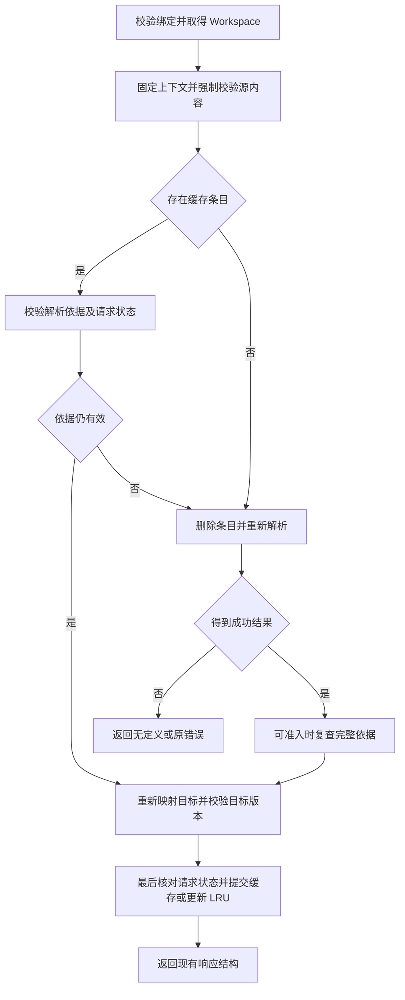

# 定义跳转结果缓存技术方案

状态：待实施设计。日期：2026-11-05。实现基线：VisualFiles 0.7.12，提交 `a91d72c`。

第一版在服务端缓存成功的定义解析结果，让“首次跳转成功，返回原处，再次查询相同位置”复用已验证的结果。缓存命中仍执行绑定、路径、源版本及解析依据校验，省去 TypeScript 解析与语义查询；不承诺零文件读取或固定的加速倍数。

本文中的新增模块、常量、流程和指标均为实施约定，当前版本尚未包含这些缓存能力。现有产品行为以 [PLAN](../PLAN.md#定义跳转与依赖边界) 为准。

## 1 目标与范围

### 目标

- 同一 Workspace、同一文件版本和同一光标位置的重复查询，在解析依据未变化时复用成功结果。
- 依赖、配置、候选路径或目录变化后重新解析，保留现有路径保护与过期内容拒绝行为。
- HEAD 与磁盘分开缓存；HEAD 结果保留提交内路径，展示时按最新重命名状态转换。
- 容量有明确上限；缓存失效、淘汰或服务重启只影响速度，不改变正确结果。

### 首版不包含

- 跨请求保留 Language Service、AST 或依赖全文；不同位置的查询通常仍需解析。
- 磁盘持久化、跨进程共享、文件监听、全量项目索引、额外后台扫描。
- 未找到定义或错误的结果缓存、并发请求合并、缓存配置界面和新 MCP 参数。
- 扩大语言、模块解析或项目外依赖的支持范围。

选择结果缓存是为了先覆盖重复查询。Language Service 和 Document Registry 可用于更广泛的语法树复用，但需要持续管理项目与文件状态，留待命中率和性能数据说明必要性后再评估。[TypeScript 官方说明](https://github.com/microsoft/TypeScript/wiki/Using-the-Language-Service-API#document-registry)

## 2 当前调用链与现有缓存

当前调用链：`CodeView → useWorkspace.findDefinition → visualfiles_read/definition → workspaceFor → definitionAt → useCodeNavigation.jump → visualfiles_read/file`。

| 位置 | 当前行为 | 与本方案的关系 |
| --- | --- | --- |
| [server.ts](../src/server.ts) | 恢复或校验绑定，刷新 Git 信息，强制读取源文件，校验 revision 与 HEAD | 这些检查必须先于结果缓存查询 |
| [definition.ts](../src/definition.ts) | 每次请求新建文件和目录 Map、Document Registry，分轮填充依赖并查询定义 | 请求结束后释放；目前没有跨请求复用 |
| [workspace-definition.ts](../src/workspace-definition.ts) | 经 Workspace 校验读取磁盘，或读取固定提交的 Git 文件 | 收集解析依据和复查依据的主要位置 |
| [workspace-files.ts](../src/workspace-files.ts) | 最多缓存两个预览文件；force 读取绕过缓存 | 与定义结果缓存分开，保持原有容量和职责 |
| [useCodeNavigation.ts](../src/ui/useCodeNavigation.ts) | 保存历史目标及选区，前进/后退重新校验目标版本 | 保留现有行为，历史定位不重新查询定义 |

缓存成功响应的对象不足以保证正确。源文件和旧目标都没有变化时，中间转导出、包入口或新出现的候选文件仍可能改变正确目标。

## 3 关键决策

| 项目 | 首版决策 |
| --- | --- |
| 缓存内容 | 成功结果的语义位置及完整校验依据；不保存响应对象、全文或 AST |
| 归属 | 每个 Workspace 独立作用域，服务进程内统一限制总容量 |
| 磁盘有效性 | 校验实际读取的文本摘要、路径身份、目录观察和缺失候选；不只比较源文件或目标 |
| HEAD 有效性 | 固定提交快照；提交标识参与缓存键，当前展示路径每次重新映射 |
| 失效方式 | 请求时验证；本插件文件操作额外主动失效；TTL 不承担正确性判断 |
| 请求取消 | 每个请求独立，取消不删除其他请求已验证的条目；取消的工作不写缓存 |
| 降级 | 不具备完整依据或超过缓存预算时执行原解析路径，不存残缺条目 |
| 对外行为 | MCP 输入、`DefinitionLocation`、快捷键、历史和持久浏览状态保持兼容 |

## 4 模块职责与 Interface

缓存的外部 seam 放在 `Workspace.definition(request, signal)`。调用方只负责先取得有权限的 Workspace，再调用该 Interface；有效性校验和缓存决策集中在模块内部，前端不负责识别缓存。

```ts
// 设计示意，实施时复用 shared.ts 中已有的 Version 和 DefinitionLocation。
type DefinitionRequest = {
  path: string;
  version: Version;
  position: number;
  revision: string;
  head?: string;
};

// 新增到 Workspace 的外部 Interface，省略既有成员。
interface Workspace {
  definition(
    request: DefinitionRequest,
    signal?: AbortSignal,
  ): Promise<DefinitionLocation | null>;
}
```

Interface 保留以下约束：位置是归一化换行后的 UTF-16 偏移；revision 是同一文本的 SHA-256；HEAD 请求必须携带预期提交。无定义返回 null，绑定、路径、版本、读取或配置错误继续抛出，不转成 null 或成功。

| 文件 | 拟议改动 |
| --- | --- |
| `src/server.ts` | 保留 `workspaceFor`；将 definition 分支现有的刷新、源读取和版本检查完整交给 Workspace 定义模块，返回结构不变 |
| `src/workspace.ts` | 持有定义模块并提供单一查询入口；文件操作接入开始/结束通知；控制在 500 行内 |
| 新增 `src/workspace-definition-query.ts` | 组织源检查、缓存验证、解析、稳定性复查和位置转换；通过 `import type` 引用 Workspace，避免运行时循环依赖 |
| 新增 `src/definition-cache.ts` | 管理私有缓存条目、作用域、字节预算和 LRU 淘汰，不执行文件系统读取 |
| `src/workspace-definition.ts` | 集中记录真实文件系统观察、稳定读取、校验依据和 HEAD 路径转换；继续使用 Workspace 路径校验 |
| `src/definition.ts` | 输出提交内或磁盘语义位置；在收敛后提供追踪依据，不直接返回已映射的展示路径 |
| `src/shared.ts` | `DefinitionLocation` 保持不变；缓存私有类型不放入客户端共享协议 |
| 前端及绑定模块 | 无需识别命中与否；保留请求过期、目标版本和聊天绑定校验 |
| README、PLAN、评审及 release | 实现完成后再将缓存标为已支持，补充验证结果，重新构建和打包 |

不引入通用缓存框架或新依赖。文件操作通知是定义模块的内部 Interface，不通过 MCP 暴露。

## 5 缓存键和条目

### 缓存键

使用结构化数组序列化，避免文件名中的分隔符造成拼接歧义：

```text
[workspaceScope, version, commitOrNull, sourcePath, sourceRevision, position]
```

- `workspaceScope` 是 Workspace 实例的进程内私有标识。不同聊天绑定、不同工作树和不同实例不共用结果；它不代替权限检查。
- `sourcePath` 经现有路径规则校验并规范化，保留大小写；HEAD 使用提交内原路径，磁盘使用工作目录内路径。
- `sourceRevision` 复用现有换行归一化与 SHA-256 规则；`position` 不转换为行列号。
- `commitOrNull` 对 HEAD 为完整提交标识，对磁盘为 null。磁盘命中同时检查请求的 HEAD 上下文是否变化；非 Git 项目使用 null。
- 不按变量名缓存，也不在首版合并同一标识符上不同偏移的请求。

### 缓存条目

```ts
type SemanticTarget = {
  path: string; // 磁盘路径或 HEAD 提交内路径，尚未做 displayPath 转换
  revision: string;
  from: number;
  to: number;
};

type CacheEntry = {
  scope: string;
  key: string;
  version: Version;
  commit: string | null;
  generation: number | null; // 磁盘条目的代次；HEAD 语义条目为 null
  target: SemanticTarget;
  observations: readonly Observation[]; // 磁盘完整依据；HEAD 使用提交快照
  bytes: number; // 规范化元数据的 UTF-8 字节数
};
```

`Observation` 的三种含义和字段见下一节。条目不持有 Workspace、Language Service、文件描述符、请求 AbortSignal 或源代码全文，避免将请求及解析上下文长期留在内存中。

## 6 磁盘解析依据

### 记录什么

必须覆盖 TypeScript 通过 host 实际依赖的全部观察，不只记录最终目标：

| 观察类型 | 保存的依据 | 典型内容 |
| --- | --- | --- |
| 文本 | 工作目录内路径、解析后的实际路径、文件身份与元数据、归一化文本摘要 | 根文件、中间模块、声明文件、tsconfig/jsconfig 继承链、package.json、声明映射等实际读取内容 |
| 目录 | 路径、实际路径和目录身份、向 host 返回的子目录/链接名称序列及摘要 | 模块查找目录、类型根目录、包目录 |
| 缺失候选 | 路径、查询种类及验证后的不存在/非目录结果、最近存在祖先的路径身份和状态 | 尚不存在的候选文件、候选配置和目录 |

设计中的私有结构如下；`PathIdentity.stamp` 包含文件类型，以及 dev、ino、size、mtimeNs、ctimeNs 的十进制字符串，`path` 均为受控工作目录内路径。

```ts
type PathIdentity = { path: string; realPath: string; stamp: string };
type Observation =
  | { kind: "text"; identity: PathIdentity; revision: string }
  | { kind: "directory"; identity: PathIdentity; entriesDigest: string }
  | {
      kind: "missing";
      path: string;
      query: "text" | "directory";
      reason: "absent" | "not-directory";
      ancestor: PathIdentity;
    };
```

每次记录的是受控读取的实际结果；目录序列摘要保留名称、类型和顺序。该缺失候选记录是成功结果的有效性依据，不是对“未找到定义”响应做缓存。

“缺失”只表示按 Workspace 规则得到的否定结果。先校验路径和最近存在祖先；仅沿用现有 ENOENT/ENOTDIR 语义。权限、越界链接和其他 I/O 错误继续抛出，不能记录为缺失。

当前同步 host 会先把“尚未异步读取”的路径暂时当成不存在，并放进 pending 集合。**只有异步读取完成后的真实结果才能形成 Observation**；不能把这类临时未知状态存成负面依据。只有 pending 已清空、解析已收敛的成功结果才具备准入资格。

目录观察保存实际提供给 host 的序列及类型，保留大小写；不在缓存层重新排序或只存目录自身的 mtime。第一版允许无关目录活动导致保守失效。

### 稳定读取

- 文本摘要必须来自解析器实际使用的那份内容。读取前后核对文件身份、大小、纳秒时间及实际路径，变化则标记本次观察不稳定。
- 根文件同样纳入依据。初始强制读取保持现有 revision 检查；解析读取器核对种子文本一致后记录根观察，不能用后来取得的指纹为旧文本背书。
- 目录枚举和缺失候选检查同样核对前后路径状态；同一路径被多次观察且结果不同，不能用最后一次覆盖后继续认定稳定。
- 同一文件既作为文本又参与目录判断时，保留对应查询种类的结果，避免文件与目录互换后误命中。

Node 的纳秒时间字段需要 `bigint: true`；时间戳可用于检测读取期间变化，但首版不会仅凭时间戳相等认定内容相同。[Node.js 文件状态说明](https://nodejs.org/docs/latest-v22.x/api/fs.html#statsmtimens)

### 再次验证

命中候选条目后，经相同受控读取路径复查全部 Observation。已存在文本重新计算内容摘要；目录重新枚举；缺失候选重新执行相同存在性判断并验证祖先。文件身份、路径或查询结果变化时，删除该条目并重新解析。

首版采取内容强校验：即使大小和时间戳相同，文本摘要仍须一致。因此命中会有依赖 I/O 和摘要计算，主要节省解析与语义查询。后续若优化为仅凭元数据跳过内容读取，必须另行定义可靠性条件及回归验证。

必须记录负面依据的例子：`./utils` 原来解析到 `utils/index.ts`，后来新增 `utils.ts`。源文件和旧目标不变，但曾不存在的候选文件变为存在，缓存必须失效。

## 7 HEAD 缓存与路径映射

HEAD 查询先校验请求中的提交与当前工作目录 HEAD 一致，再固定本次 Git 快照。依赖和配置全部来自该快照，不使用磁盘 node_modules；原有未提交依赖不可跳转的限制保持。

同一提交下的成功语义位置可复用，不逐个校验磁盘依赖。Git 读取继续按提交树和 blob 对象进行，工作目录为仓库子目录时保留现有 prefix 限制。[Git 树读取说明](https://git-scm.com/docs/git-ls-tree)

缓存保存提交内路径，不保存 `DefinitionFiles.displayPath()` 的结果。每次返回前，使用本次完整 Git 状态重新计算重命名映射，再构造客户端需要的 `DefinitionLocation`。缓存中的旧路径必须接受同样的范围校验，不能因命中而绕过。

例如提交内为 `src/lib.ts`，当前已重命名为 `src/new-lib.ts`。两次查询的语义结果可以相同，但当前面板应打开的新路径由最新状态决定。HEAD 在请求期间变化时返回版本变化错误，不能自动跳到另一个提交。

正常 Git 对象按内容寻址是本方案的前提。若启用 replace refs 等改变同一提交标识解析视图的机制，首版应在 HEAD 查询开始及入缓存前通过 Git 命令检查 replace refs；存在替换视图或无法确认普通快照条件时禁用该次 HEAD 结果缓存，保持原有无缓存解析；不能只用原提交标识认定视图不变。[Git 对象替换说明](https://git-scm.com/docs/git-replace)

## 8 请求处理流程



### 命中路径

1. `workspaceFor` 校验聊天绑定；定义模块刷新完整 Git 信息并捕获当前上下文。
2. 保持源文件强制读取、可读文本检查、revision、位置、语言及预期 HEAD 校验；输入错误不查询缓存。
3. 生成键并查条目。验证磁盘全部依据，或验证 HEAD 固定快照条件；检查请求 generation、取消状态和写操作状态。磁盘条目还须匹配创建代次，HEAD 语义条目不受磁盘条目代次限制。
4. 发现普通变化则驱逐并进入冷解析；发现权限、越界或 I/O 错误则抛出原错误，不返回缓存值。
5. 按新 Git 状态转换目标路径，验证目标文本 revision 及范围；变化则重新解析，失去访问权限则报错。
6. 仅在完整验证成功后更新 LRU 顺序并返回。验证期间条目已被删除或替换时按未命中处理，不将旧引用放回。前端随后仍按现有 file 请求重新校验目标。

### 冷解析路径

1. 使用本次固定的读取上下文，按现有分轮逻辑解析并记录真实观察。
2. 无定义、错误、取消或不支持的语言不入缓存；源版本或 HEAD 不符继续报错。
3. 对可准入的成功结果复查完整依据，防止将解析过程中已变化的依赖封存为有效条目。
4. 依据稳定后，转换展示路径并校验目标 revision、可读性及范围；目标检查失败不写缓存。全部检查通过且请求仍有效、预算允许时，原子地更新条目及容量计数，再返回目标。
5. 仅依赖发生变化且源 revision、HEAD 仍有效时，最多重新解析一次；再次不稳定则提示文件正在变化，请稍后重试。

缓存元数据超过准入预算时，不额外制造解析失败：停止收集缓存材料，继续原无缓存路径；保留源/目标版本与错误保护，不存截断后的依据。无缓存解析自身触及原有资源上限时，仍按原规则报错。

## 9 并发 取消与一致性

### 本插件写操作

定义模块维护 Workspace 内的 `generation` 和正在执行的写操作数。`Workspace.mutate` 在进入操作前及 finally 中通知定义模块：递增 generation，并清理磁盘结果。即使操作失败，也按可能发生过部分变更处理；不改变原有错误传播及数据保护。

有写操作进行时不发布缓存结果。解析或验证开始时捕获的 generation 在任何 await 之后都可能过期，必须在返回候选结果和写入前重新核对；过期工作不能在清理后重新填回旧条目。

普通自动刷新、选区移动和滚动不清空缓存。定义查询观察到 HEAD 上下文变化时使磁盘条目失效；HEAD 条目按提交键隔离，展示路径仍重新计算。HEAD 请求中若只有工作目录写操作使请求代次过期，保留语义条目，最多重新捕获一次完整 Git 状态并复核源、HEAD 和路径映射；再次不稳定则提示稍后重试。

### 外部修改与取消

外部编辑器、Git 命令、包管理器和其他进程不会更新本 Workspace 的 generation。其变化依赖内容、目录和缺失候选复查来发现；Git status 的路径清单不能代替这些检查，尤其是已忽略依赖和一直处于 M 状态的文件。

首版不合并进行中的请求。两个相同请求允许各自解析，分别响应取消，避免一个请求的 AbortSignal 取消其他请求。校验和解析分批进行，每批沿用现有最多 16 个文件系统/Git 操作的并发限制，并检查取消。

取消、校验、LRU 提交之间的最后检查与 Map 更新应在同一无 await 的同步段完成；该同步段同时确认 generation 和条目容量。并发请求写入同键时，只接纳各自验证通过的完整条目，不把两个请求的依赖集合拼接。

### 一致性承诺

复查结果只用于本次请求，不能把“刚校验过”作为后续几秒内免校验的依据。读取前后核对与解析后复查用于发现可观察变化，不提供整个工作目录的事务快照或外部文件锁。

外部写入可能发生在最后一次校验之后。打开目标时现有 revision/HEAD 检查继续负责拒绝过期位置；缓存也不能保证目标打开瞬间所有中间依赖仍未变化。需要严格原子快照的场景应使用固定提交，不能用 TTL 或 generation 宣称已解决。

## 10 生命周期 容量与降级

以下是首版内部常量的初值，性能验收后可调整；不新增用户配置。

| 限制 | 初值 | 到达上限的行为 |
| --- | --- | --- |
| 单条元数据 | 1 MiB | 本次不缓存，正常返回解析结果 |
| 单 Workspace 条目 | 32 条且 4 MiB | 淘汰该作用域最久未成功使用的条目 |
| 单服务进程条目 | 128 条且 16 MiB | 跨作用域按 LRU 淘汰，保持作用域隔离 |
| 原解析限制 | 单文件 12 MB、100 轮、100000 个候选路径、64 MB 文本 | 继续按现有规则报错 |
| 每轮依据复查 | 最多读取对应 64 MB 文本；按既有并发限制分批 | 不能完整验证则不命中；可准入性不足时走无缓存路径 |
| 不稳定重试 | 每请求最多一次重新解析 | 再次不稳定报错，不无限重试 |

缓存预算按规范化元数据的 UTF-8 字节数计算，不等同于 JavaScript 实际堆占用。文件状态中的 bigint 转为明确的十进制字符串用于指纹和计量，不进入 MCP 响应。全局 LRU 不持有 Workspace 对象；每条都带私有作用域，禁止跨作用域查中。

源检查、解析和复查分别有受控读取预算；不得将复查读取量误计为“新加载文本”而让原本满足解析限制的项目因启用缓存直接失败。一次重试仍受总尝试次数约束，基准应报告完整请求的实际读取量和耗时。

新建 Workspace 或在另一进程恢复绑定会产生新的作用域，缓存默认冷启动。复用同一进程内已有绑定时，可继续使用该 Workspace 的条目。切换项目不会复用旧作用域；旧条目受进程总预算淘汰。服务重启、另一 MCP 进程处理请求或重新安装插件后不保证命中，也不恢复缓存文件。

TTL 不作为有效性条件，首版不添加时间过期策略。暂不维护反向依赖索引；单次不一致先删除对应条目，其他条目被查询时各自验证。

## 11 场景覆盖与预期行为

| 场景 | 预期行为 |
| --- | --- |
| A 跳到 B，返回 A，再查同一偏移 | 全部依据稳定时命中，目标与冷解析一致 |
| 返回后使用 Alt＋→ | 使用现有历史目标并校验目标，不进入定义缓存查询 |
| 同一文件另一个符号或同一符号不同偏移 | 新键，首版通常冷解析 |
| 源文件插入空行、同名变量位于不同作用域 | 源 revision 或偏移区分，不复用错误位置 |
| 目标插入空行、内容改变、原子替换或删除 | 校验失败后重新解析；不把旧偏移直接用于新内容 |
| 目标不变，中间转导出改变 | 中间文件摘要失配，重新解析到新目标 |
| 新增 utils.ts 遮蔽原 utils/index.ts | 缺失候选变为存在，重新解析 |
| 新增就近 tsconfig/jsconfig 或更改 extends/paths | 候选配置或已读配置变化，重新解析 |
| npm 安装、包入口或声明改变 | 相关文件、目录或缺失候选变化，重新解析；不依赖 Git 忽略状态 |
| 缺失模块后来生成；第一次返回 null | null 未缓存，下一次正常查询 |
| 同步 host 暂时未知，异步加载后得到成功结果 | 只记录异步读取的真实依据；pending 未收敛不得入缓存 |
| 大小与时间戳相同但内容不同 | 文本摘要失配，重新解析 |
| 文件与目录互换、大小写重命名、链接重定向 | 查询种类或路径身份变化；安全变化重解析，越界或权限错误直接反馈 |
| 切分支、提交、worktree 或非 Git 目录 | 上下文及作用域隔离；磁盘仍检查实际依赖 |
| HEAD 同提交重复查询 | 可复用语义位置，继续源检查、展示映射及目标检查 |
| HEAD 原路径已在磁盘重命名或删除 | 使用最新映射及现有文件查看规则，不返回旧展示路径 |
| 请求途中写操作、依赖改变或 HEAD 改变 | 过期 generation 不写回；依赖至多重试一次；源/HEAD 过期拒绝 |
| 两请求同时查询，其中一个取消 | 独立完成或取消，已验证条目不受另一请求取消影响 |
| 大图、缓存已满、多项目或服务重启 | 淘汰或不准入后正常冷解析，不扩大访问范围或静默忽略解析错误 |

## 12 验收与性能测量

### 功能与保护

行为验收在仓库外临时项目运行，并通过与生产相同的 `Workspace.definition` Interface、真实 MCP 调用和浏览器路径验证；测试替身只用于可控文件变化、时间和取消时机。每项失效场景均比较缓存开启路径与强制冷解析路径的语义目标及 revision。

- 覆盖上表所有场景；检查命中路径没有调用 TypeScript 定义解析，失效路径确实重新调用；任何最终源/目标检查失败、取消或错误响应都不得写入新条目。
- 使用屏障安排“读后改配置”“验证中改依赖”“失效后旧请求完成”“写操作失败”“目标校验前替换链接”等时序，验证旧条目不能写回。
- 验证隐藏/忽略依赖、嵌套项目配置、包声明、CRLF、UTF-16 偏移、中文/空格/分隔符路径及仅大小写变化。
- 验证 ENOENT/ENOTDIR 的缺失语义与 EACCES、越界、二进制、过大文件、Git 失败的真实错误传播。
- 预填条目后发起跨聊天、无效绑定和未登记项目请求，确认不能通过缓存绕过现有绑定恢复及路径校验。
- 断言单条、作用域、进程 LRU 字节和条数上限；超大 trace 不得截断入缓存；首版未找到、错误和取消都不新增条目。
- 浏览器验证 F12、⌘ 点击、跨文件历史及 HEAD 定位；返回结果时已切换文件或选区的请求仍被前端丢弃。

### 性能方法与准入

使用同一隔离项目、同一 Node/TypeScript 版本和固定源内容，比较现有无缓存基线、首次可准入解析、连续命中、依赖变化失效和预算不足降级。选择小项目、多级转导出、较大 node_modules 图及 HEAD 查询，每组预热运行时后至少记录 30 次请求，交错测量缓存与无缓存路径，保持操作系统文件缓存条件可比，分别记录 P50/P95。

记录端到端耗时、Git/源检查耗时、依据验证耗时、解析耗时、命中/失效原因、实际读取字节数、TypeScript 调用次数、缓存元数据和进程堆/RSS。诊断统计仅在隔离验收中收集，不增加生产 UI、遥测或输出源内容。

| 验收项 | 首版标准 |
| --- | --- |
| 正确性 | 所有稳定结果与冷解析一致；失效、权限和版本检查通过，无错误命中 |
| 命中路径 | TypeScript 定义解析调用为 0；仍能观察到必要依据验证 |
| 暖请求收益 | 代表性依赖项目 P50 初始目标不高于无缓存基线的 50%，P95 有改善；结果需实测，不作为已达到的性能声明 |
| 首次解析成本 | 可准入首次请求 P50 初始目标不高于基线的 125%；超出需解释复查成本并调整准入，不能省略校验 |
| 内存 | 连续查询和多项目下条目受预算约束，淘汰后不保留 AST/全文；报告实际堆/RSS，不用元数据预算代替实测 |
| 降级 | 不准入、淘汰和重启后仍可正确解析；缓存预算不足不变成业务错误 |

安全与正确性是硬标准；性能数字是待验证的实施目标。若强校验已占主要成本，应报告收益不足并调整缓存准入或重新评估下一阶段，不以放宽失效条件取得指标。

## 13 实施步骤与交付

1. 在隔离环境记录当前重复跳转基线，补齐根文件、中间依赖、缺失候选和配置变化的对比样例。
2. 实现读取观察与稳定性判断，先验证同一 Interface 下的冷解析结果及错误语义保持一致。
3. 提取 Workspace 定义查询模块，完整迁移现有源检查与 HEAD 捕获逻辑，接入磁盘验证和 HEAD 原路径缓存。
4. 添加容量受限的进程 LRU 与 Workspace 私有作用域，接入文件操作开始/结束通知和取消处理。
5. 完成功能、并发及性能矩阵，依据实测确认默认容量与准入策略；实施中每个手工文件保持 500 行以内。
6. 同步类型、调用方与文档；执行 `npm run check`、构建、打包，提交本次源码和生成的 release 产物；清理隔离验收文件。
7. 按用户授权推送后等待自动发布完成，再更新本机插件。真实 Codex 宿主验收单独记录，不能用浏览器验收代替。

回退时移除结果缓存查询与写入，保留无缓存定义解析、现有源/目标版本校验及历史定位。缓存仅在内存中，无数据迁移、缓存文件清理或用户项目恢复步骤。

## 14 风险与设计限制

- 内容强校验仍会读取依赖；大图或频繁生成文件的项目可能加速有限，甚至经常不准入，需要以基准确认收益。
- 追踪整个解析过程而非精准符号依赖，会因无关文件或目录变化保守失效；首版接受较低命中率以控制实现复杂度。
- Node 的并发文件系统操作不会为项目提供同步快照；两阶段复查也无法保证返回后的外部文件不再变化。[Node.js 文件系统并发说明](https://nodejs.org/docs/latest-v22.x/api/fs.html#promises-api)
- 首版面向常规本地文件系统；不宣称能在恶意恢复元数据、异常文件系统语义或 Git 对象视图动态替换下提供事务一致性。HEAD 视图不满足固定快照条件时应禁用该次缓存。
- 32 条/4 MiB 的 Workspace 预算和进程总预算只约束结果元数据；当前解析过程的临时内存与既有绑定生命周期另行计算。
- 相同符号不同位置、跨 Workspace、跨进程及服务重启没有命中保证；更多语言、项目全局声明扫描等现有限制保持。
